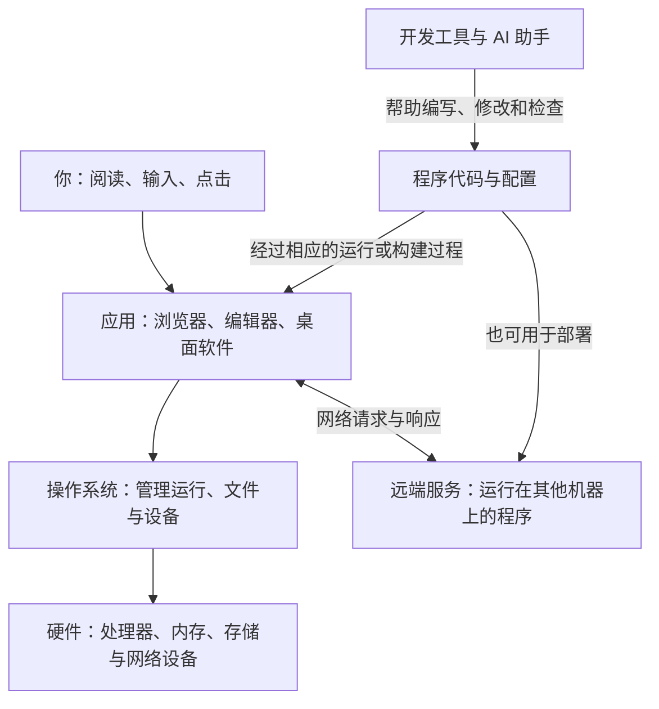

# 一张图看懂计算机、程序与软件开发

你让 AI 写一个“记录读书进度的小工具”。它很快给出几份代码，还让你打开终端、安装依赖、启动服务。页面终于出现了，但接下来遇到的问题越来越陌生：这些文件分别做什么？为什么关闭终端后页面不能用了？记录到底保存在自己电脑上，还是保存在网上？

这些疑问跨越了好几个层次：文件结构属于项目组织（见[第 25 篇](25-project-layout.md)），关闭终端导致网页失效是因为后台服务进程随之结束（见[第 04 篇](04-programs-processes.md)），而数据保存在哪里则取决于前端、后端与数据库的分工（见[第 19 篇](19-backend-api.md)、[第 20 篇](20-database.md)）。先把它们放在一张图里，后面的术语就有了位置。

## 从正在使用的软件往下看

打开一个记事本，你看见窗口、文字和保存按钮。窗口背后有运行中的程序；程序需要处理器执行指令，需要内存容纳正在处理的信息，还要通过操作系统读取键盘、访问文件和显示内容。文件通常保存在 SSD 等长期存储设备上。

如果使用的是在线笔记，还会多出另一台或多台电脑：浏览器通过网络联系远端程序，远端程序负责处理请求、保存数据，再把结果送回来。“云端”里的软件也需要运行在实际的机器上，只是这些机器由其他人或服务商管理。

图中表示的是职责关系。实际系统还有运行时、驱动、缓存等中间环节；浏览器也会替网页承担许多运行管理工作。现在先看清几件事：谁在执行，信息放在哪里，哪一部分需要跨网络通信。

## 代码、程序和软件，指的是同一件事吗

**代码**通常指人用编程语言写下的文本。它描述要处理的数据、执行的操作和需要遵守的规则。例如，根据一本书的总页数和已读页数计算阅读进度，就是可以用代码表达的规则。

**程序**强调能够被执行的指令与相关内容。日常交流中，人们也会把一份待运行的代码称为程序。要让源代码真正产生作用，需要相应的运行机制：有的先编译成系统能直接启动的可执行文件（如 Windows 上的 `.exe`），有的则交给已安装的解释器或运行时处理（如用 `python` 命令运行 `.py` 文件，或用 `node` 运行 `.js` 文件）。具体过程会在[第 07 篇](07-languages-runtime.md)展开。

**软件**的范围往往更大。除了程序，它还可能包含图片、配置、数据文件、安装方式和配套文档。一个可持续使用的在线服务，还涉及部署、数据管理和维护。拿到一段代码，是获得了其中的一部分。

因此，AI 输出一个文件，不代表这个文件会自己开始运行。它需要放在合适的位置，由正确的工具按相应规则处理。你修改了代码，也不必然意味着正在运行的那个程序已经使用了新版本。

## 几种软件形态，区别在哪里

桌面软件、手机应用、网站和脚本都利用计算机处理信息，差别主要在运行环境、交互方式和分发方式。

| 形态 | 你通常怎样使用它 | 理解时可以关注什么 |
| --- | --- | --- |
| 桌面软件 | 在电脑上启动一个应用 | 它如何使用本机的文件、设备与操作系统能力 |
| 手机应用 | 在手机中打开应用 | 手机系统提供的能力、权限和生命周期 |
| Web 应用 | 在浏览器中访问网址 | 浏览器里的代码与服务器上的代码怎样配合 |
| 脚本 | 通过命令或其他程序启动 | 输入来自哪里，处理后把结果输出到哪里 |

这些类别会重叠。桌面应用可以访问网络，网站可以具有部分离线能力，脚本也可以生成网页。看到一个界面，并不能仅凭外观判断它的数据保存在什么地方。

“前端”和“后端”主要描述应用中的职责。前端负责用户直接接触的界面和交互；后端负责服务端的处理。在 Web 应用中，两者常通过网络接口交换信息。数据库负责组织和保存数据，本身也是软件。后面的 Web 部分会用一次具体操作把这些概念连接起来。

## 软件开发做的是哪些工作

编写代码是开发中的核心活动之一。围绕代码，还有一连串互相影响的工作：弄清需求，把需求分成可表达的规则，选择程序的组织方式，找到问题，检查行为，记录修改，发布新版本，以及处理使用过程中出现的变化。

以“记录读书进度”为例，“进度”本身就需要说明：按页数还是章节计算？一本书修改总页数后，过去的记录怎样处理？没有联网时能否保存？这类问题在写代码之前就已经存在，使用 AI 也不会使它们自动消失。

开发工具帮助人完成这些工作。编辑器便于阅读和修改代码，终端提供与程序交互的文字入口，版本管理记录变化，调试工具提供运行中的线索。工具的界面可以更新，它们所解决的问题通常更稳定。

## AI 在这张图中的位置

AI 编程助手可以解释代码、提出修改、生成文件，也可能在获得相应工具和权限后运行命令、查看结果。它参与了开发过程。

开发出来的软件是否包含 AI 功能，是另外一个设计选择。你可以用 AI 帮助编写一个普通计算器，计算器运行时并不需要再向模型提问；也可以开发一个摘要工具，在用户使用它时调用模型。这两种情况下，AI 出现的位置不同。

这里用“AI 编程”泛指借助 AI 理解、生成、修改和检查代码等活动。项目名中的 Vibe Coding 保留了这一主题背景；这个词的不同用法在[AI 编程与 Vibe Coding](32-ai-coding.md)中说明。

## 怎样阅读这份教程

如果希望建立连贯的认识，可以从[CPU、内存、磁盘与操作系统](01-computer.md)继续，逐步看到数据如何表示、代码如何运行、网页如何通信，以及软件如何被开发和维护。

如果手上已有一个具体困惑，可以从[常见问题索引](../questions.md)进入。遇到陌生概念，再回看相应专题或查阅[术语速查表](../glossary.md)。

碰到没讲清的地方，可以按[反馈说明](../../CONTRIBUTING.md)指出所在篇目和具体困惑。你需要带着走的，是一套能把新名词放回整体结构里的认识。

> [!TIP]
> **实战提示**：当你拿到 AI 生成的一堆文件不知从何下手时，可以先问它：**「请列出这个项目的入口文件、启动命令，以及数据保存在哪里（内存、本地文件还是远端服务）？」**

<!-- navigation -->

---

[完整目录](../../README.md) · [按问题查阅](../questions.md) · [下一篇：CPU、内存、磁盘与操作系统](01-computer.md)
