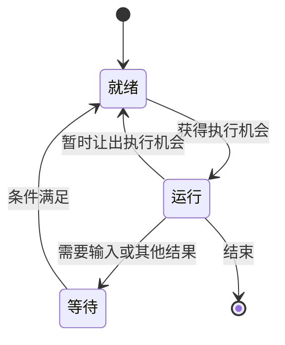

# 程序、指令与进程

电脑里的一份程序文件可以安静地存放很久。你启动它之后，系统才需要记录它执行到了哪里、使用了什么数据，以及正在等待什么。描述这次运行活动的基本概念，就是**进程**。

## 指令比源代码更具体

人写的源代码使用变量、函数等表达方式。CPU 实际执行的是它所支持的机器指令。可以用下面的抽象步骤理解一小段计算，注意它们只是教学示意，不是某个处理器的真实汇编语法：

```text
读取两个数
计算它们的和
记录结果
根据某个条件选择接下来的步骤
```

执行时，处理器需要知道要取哪条指令，以及操作涉及哪些数据。寄存器用来保存处理器当前直接使用的一些值，其中包括与执行位置相关的状态。程序中的分支和循环，最终也要通过相应执行机制实现。

现代处理器内部会并行处理、预测或重排某些工作，同时维持其规定的可观察行为。把执行理解为“按程序规定完成操作”是入门模型，不应进一步误认为每条源代码都只对应一条机器指令，或者永远按纸面顺序逐条占用一个完整步骤。

## 从程序文件到一次运行

启动一个程序时，系统会建立执行所需的状态，准备相应的内存映射、输入输出资源和初始参数，然后让执行从规定的位置开始。具体装载过程可以按需进行，不要求把所有程序内容一次性读入物理内存。

一份已安装的程序可以启动多次。两次运行可能使用同一套程序文件，却处理不同的数据，拥有不同的执行状态。程序和进程的关系可以粗略理解为“可执行的内容”与“正在发生的一次执行”。[OSTEP 的进程章节](https://pages.cs.wisc.edu/~remzi/OSTEP/cpu-intro.pdf)详细解释了这一抽象。

系统通常给进程分配标识，称为 PID。它用来区分当前的运行活动，不是软件永久不变的编号。程序重新启动后，标识和内部状态可能不同。

## 运行中的程序并不一直占用 CPU

编辑器等待你按键时，不需要始终忙着计算。网络程序等待远端回复时，也可能暂时没有可继续执行的工作。系统可以把处理器交给其他就绪的任务。

可以用三个简化状态理解这个过程：



不同系统的真实状态分类更细。这里的重点是：**进程存在，不代表它正在计算；等待也不等于故障。** 系统的调度机制在多个可运行任务之间分配执行机会，多核处理器还能让部分工作同时执行。

## 线程为什么又出现了

一个进程内部可能需要处理多条执行活动，例如一边接收输入，一边等待网络或完成后台计算。线程是许多系统中用来安排这些执行活动的基本单位。

同一进程中的线程通常共享进程的地址空间和部分资源，同时各自保留执行位置和调用栈等状态。共享便于交换数据，也意味着它们对同一份数据的修改需要协调。[Microsoft 的进程与线程说明](https://learn.microsoft.com/en-us/windows/win32/procthread/processes-and-threads)展示了 Windows 中相关概念的分工。

一个应用也可能使用多个进程。浏览器就是容易遇见这种组织方式的应用类别。看到多个进程，不足以直接说明启动了多个完全独立的应用，更不能仅凭进程数量判断是否异常。

## 应用怎样请求系统能力

应用要读取文件、建立网络连接或创建新的运行活动，需要使用系统提供的能力。涉及受控内核功能时，会通过系统调用等机制进入相应处理路径。普通的数值运算则不需要每做一步都向操作系统提出一个单独请求。

这条边界使系统能够检查请求、安排资源并实施隔离。进程通常不能任意直接访问其他进程的全部内存；需要共享或交换数据时，系统和程序会采用明确机制。

因而，“程序卡住”需要继续细分。它可能在等待输入，可能等待一个迟迟没有返回的请求，也可能持续计算或陷入不恰当的循环。下一步该查看什么，取决于它实际处于哪一种情况。理解进程的活动与等待，为后面的调试和异步概念提供了基础。

<!-- navigation -->

---

[上一篇：文件、目录、路径与权限](03-files-paths.md) · [完整目录](../../README.md) · [按问题查阅](../questions.md) · [下一篇：内存里的数据去了哪里](05-memory.md)
