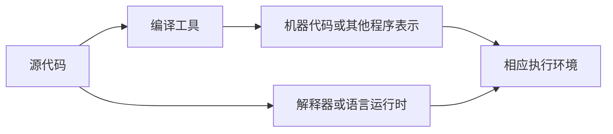

# 编程语言与程序的运行

一份代码文件可以用文本编辑器打开，但“能看见内容”和“能执行内容”是两件事。要理解 AI 给出的运行步骤，先要看清编程语言、源代码、运行时和操作系统之间的关系。

## 语言规定怎样表达，工具负责怎样执行

编程语言规定可以使用哪些表达形式，以及它们应具有什么含义。程序员按照这些规则写出的文本称为源代码。不同语言可以用不同语法表达相似逻辑。

例如，下面是一个完整的 Python 3 小片段：

```python
pages_per_day = 12
days = 8
print(pages_per_day * days)
```

它输出 `96`。前两行给两个数量命名，最后一行计算并显示结果。你现在不必记住每个符号，后面会逐一解释。

把这些文字保存成文件以后，仍然需要相应的 Python 解释器去读取和执行它（例如在项目根目录的终端里运行 `python examples/python/07-languages-runtime-01.py`，macOS/Linux 上常见为 `python3 ...`）。Python 源代码不会仅凭扩展名就变成 CPU 直接认识的机器指令；如果在 Windows 资源管理器里直接双击 `.py` 文件，即使启动了窗口也往往会在打印完结果的瞬间自动关闭。本教程选择 Python 3 展示多数程序逻辑，是因为这类短片段比较容易阅读；涉及网页界面时会使用浏览器里的语言与机制。

## 编译和解释分别在说什么

**编译**描述把一种程序表示转换为另一种表示的过程。转换目标可能是机器代码，也可能是中间表示、字节码，甚至另一种源语言。

**解释执行**则由某个程序读取并执行另一份程序表示的含义。这个解释器本身，也是运行在计算机上的软件。

真实实现可以结合多种方式。例如，常见的 CPython 实现会先把 Python 源码转换成供其虚拟机处理的字节码。某些运行环境还会在运行过程中把热点代码编译成机器代码，这类机制通常与即时编译有关。因此，简单地给所有语言贴上“永远只编译”或“永远只解释”的标签，会掩盖具体实现。



图中列出了几种可能路径，不表示每种语言都必须逐项经过它们；同时要注意，**解释器或语言虚拟机本身也是已经编译成机器代码的程序**，因此所有路径最终都要落到 CPU 执行机器指令。

## 运行时提供什么

“运行时”可能指执行程序所依赖的一组支持机制，也可能指提供这些机制的软件环境。它可以负责对象表示、内存管理、异常处理或语言与操作系统之间的连接。不同工具对这个词的具体范围有所差异，阅读时需要结合上下文。

这也是“电脑上已经有编辑器，为什么还要安装别的东西”的原因之一。编辑器只负责读写代码文本；真正运行某种语言，还需要对应的执行环境：

| 常见文件 | 依赖什么环境 | 常见启动方式 |
| --- | --- | --- |
| `.py`（Python 源码） | Python 解释器 | 终端运行 `python app.py` 或 `python3 app.py` |
| `.js` / `.ts`（服务端或构建脚本） | Node.js、Deno 或 Bun 等运行时 | 终端运行 `node server.js` 或 `npm run dev` |
| `.html` / 网页前端 `.js` | 浏览器（内置渲染与 JS 引擎） | 浏览器打开页面，或通过本地开发服务访问 |
| `.exe`（Windows 可执行程序） | Windows 操作系统及所需动态库 | 直接运行或双击启动 |

浏览器也提供一种运行环境：它读取页面结构和样式，并为网页脚本提供访问页面（如 `document`）和网络等能力。同一门语言在不同运行环境中，可使用的接口并不相同：不能仅因为两份文件都写着 JavaScript，就假定它们在浏览器和服务器端拥有完全相同的能力（例如在 Node.js 中直接访问浏览器特有的 `document` 会报 `document is not defined`，而在浏览器页面脚本中也不能直接调用 Node.js 的本地文件模块 `fs`）。

## 跨平台为什么还会遇到问题

源代码、机器代码和运行环境具有不同层面的可移植性。某种机器代码面向特定的处理器指令体系（如常见的 `x86_64/amd64` 与苹果 M 系列芯片、部分移动端使用的 `ARM64/aarch64`，下载软件安装包时经常需要在这两者之间选对架构）和操作系统约定；同一份源代码则可能通过不同平台上的工具运行。

即使语言本身提供跨平台能力，程序仍可能依赖某种文件路径、系统接口、外部库或环境设置。因此，“这种语言支持多个系统”不能保证每个用它写出的项目都可以不经调整地到处运行。

遇到“无法运行”时，可以依次确认文件用什么语言、要求什么实现或环境、由什么入口启动，以及还依赖哪些内容。这样的描述比“这个文件是代码，所以应该直接双击运行”更准确。

语言怎样表示对象和执行程序，可进一步阅读 [Python 数据模型](https://docs.python.org/3/reference/datamodel.html)。本教程中的短示例使用 Python 3 的稳定语法，不依赖第三方包。

> [!TIP]
> **实战提示**：看到 `.py`、`.js`、`.ts` 文件时，先分清它运行在哪个环境：**浏览器里的 JavaScript 不能直接读写本机任意文件，Node.js 里也没有浏览器的 `document`。**

<!-- navigation -->

---

[上一篇：终端、命令与运行环境](06-terminal.md) · [完整目录](../../README.md) · [按问题查阅](../questions.md) · [下一篇：变量、值、类型与表达式](08-values-types.md)
