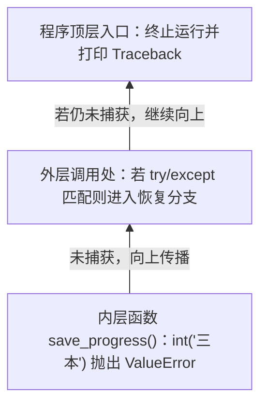

# 错误与异常

程序“不对”至少可能有几种含义：代码不符合语言规则，运行途中某项操作无法完成，或者程序顺利结束却算出了不符合需求的结果。把它们分清，才能知道该从哪里解释问题。

## 三类常见情况

**语法错误**（如 Python 的 `SyntaxError`、`IndentationError`）表示代码的写法不符合语言的结构规则，例如缺少必要符号或不正确的缩进。在 Python 等语言中，文件执行前会先经过整体语法解析：只要文件里有一处语法错误，哪怕错在最后一行，整个文件也不会开始执行。

**运行中的异常**发生在代码执行某项操作时，例如把不能表示整数的文本交给整数转换，或者尝试打开不存在的文件。异常可以携带类型、说明和调用位置等信息。



**逻辑错误**则可能没有任何语言层面的报错。比如代码把“剩余页数”写成“已读页数”，每一行都能执行，结果却不符合需求。语法检查和程序能够启动，都不足以单独说明业务逻辑正确。

## 读错误信息要连接到上下文

Python 的异常输出（Traceback）包含调用过程和最后的异常类型。未被捕获的异常会沿着函数调用栈一层层向上传播，最终终止程序并打印出如下回溯信息（浏览器 `F12` 控制台中的 JavaScript 报错调用栈同理）：

```text
Traceback (most recent call last):
  File "D:\reading-notes\app\main.py", line 12, in <module>
    save_progress("三本")
  File "D:\reading-notes\app\main.py", line 5, in save_progress
    count = int(raw_count)
ValueError: invalid literal for int() with base 10: '三本'
```

阅读时可以按三步走：① **先看最后一行**，冒号前是异常类型（`ValueError`），冒号后是具体原因；② **从下往上找属于自己项目的文件和行号**（`most recent call last` 表示越往下越接近出错点，若最底层是第三方库内部代码，就往上找自己项目的调用处，如这里的 `main.py` 第 5 行）；③ **对照常见异常类型判断方向**：`NameError`（名字拼错或未定义）、`TypeError`（类型不匹配或参数个数不对）、`AttributeError`（常见于前一步意外拿到了 `None`，报 `'NoneType' object has no attribute ...`）、`KeyError` / `IndexError`（字典缺键或列表下标越界）、`ModuleNotFoundError`（包未安装或跑错了虚拟环境）、`FileNotFoundError`（路径或工作目录不对）。

最后出错的一行很重要，但根因不一定只在那一行。它收到的错误数据可能来自更早的读取、转换或调用。只把最后一句报错交给 AI，有时会丢掉解释问题所需的上下文。

文件位置和行号也属于当前版本。代码一旦被修改，旧截图里的行号可能不再对应相同内容。调试时应同时保留产生错误的输入、运行条件和实际版本。

## 捕获异常，是规定失败后怎么走

```python
raw_count = "三本"

try:
    count = int(raw_count)
except ValueError:
    print("数量需要写成整数，例如 3。")
else:
    print(f"收到 {count} 本书。")
```

这段代码会输出输入提示。`int` 无法按这里的规则把 `三本` 转为整数，于是进入匹配的异常处理分支。成功路径则放在 `else` 中。[Python 的错误与异常教程](https://docs.python.org/3/tutorial/errors.html#handling-exceptions)说明了这些控制流程。

捕获异常并没有让原先失败的转换自动成功。审查 AI 生成的代码时，要特别警惕形如 `except Exception: pass`（或空的 `catch (e) {}`）这类**无声吞掉所有异常**的写法——如果捕获错误后既不记录也不反馈，甚至继续告诉用户“处理成功”，界面虽然安静了，故障却被掩盖了。

## 失败时已经发生了什么

有些操作包含多个步骤。保存记录失败时，可能连请求都没有发出，也可能服务器已经保存，只是返回结果在网络中丢失。这两种情况需要不同的解释和处理。

因此，错误处理还应考虑操作的边界：失败前哪些修改已经发生，是否可以再次尝试，重复执行会不会产生另一条记录。后面的事务和 Web 流程会进一步展开这些问题。

## 错误、日志与提示并不相同

异常是程序执行机制中的一种信号；日志是程序留下的观察记录；给用户看的提示则是界面表达。它们可以互相关联，但不必逐字相同。

一段面向开发者的调用信息可能太细，不适合全部显示给普通用户；一条简短用户提示又可能不足以定位问题。程序需要让不同读者获得合适的信息。

与 AI 讨论错误时，尽量指出预期行为、实际行为、最小相关输入以及完整的关键输出。还可以让它先解释证据支持哪些原因，再选择要验证的假设。把“没有显示报错”当作唯一目标，容易得到只隐藏现象的修改。

> [!TIP]
> **实战提示**：向 AI 提问报错时，**请从 `Traceback (most recent call last):` 第一行一直复制到最后一行异常类型**，并检查 AI 的修复是不是只用 `except Exception: pass` 把错误藏了起来。

<!-- navigation -->

---

[上一篇：模块、接口与程序组织](11-modules-interfaces.md) · [完整目录](../../README.md) · [按问题查阅](../questions.md) · [下一篇：等待、异步与并发](13-concurrency.md)
