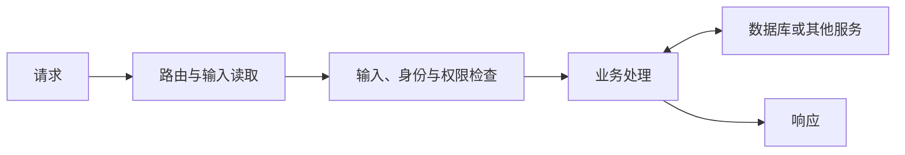

# 服务器、后端与 API

页面里的按钮可以请求保存数据，但保存到哪里、由谁检查、按什么规则处理，需要后端承担相应工作。后端是在服务端运行的程序及相关逻辑，“服务器”则可能指该程序扮演的角色，也可能指承载它的机器。

## API 是程序之间的使用约定

API 可以理解为软件向其他软件提供的调用接口和约定。它需要让使用者知道允许请求什么、输入怎样表达、结果怎样返回，以及失败如何说明。

Web API 通过网络提供这种交互。一个地址只是其中一部分，还需要方法、参数、内容格式、身份要求和错误语义。例如，一套虚构的读书记录接口可能这样安排：

| 请求 | 约定用途 | 调用者还需要知道什么 |
| --- | --- | --- |
| `GET /api/books` | 获取可访问的书目 | 怎样筛选、分页，结果有哪些字段 |
| `GET /api/books/1` | 读取编号为 1 的记录 | 记录不存在或无权访问时如何响应 |
| `PATCH /api/books/1` | 更新部分字段 | 允许修改什么、输入怎样校验 |

这些路径与行为由应用自行设计并约定，并非 HTTP 协议自带的固定功能。

## 请求进入后端以后

服务器先根据方法和路径把请求交给相应的处理逻辑，这一对应关系常称为路由。处理逻辑再读取输入、检查身份和权限、执行业务规则，必要时访问数据库，最后组织响应。



不同系统会把这些步骤组织在不同组件中，图示重点是职责，不是要求所有项目采用固定文件数量。

## 输入格式正确，还需要符合规则

假设更新进度时提交了下面的 JSON：

```json
{"read_pages":60}
```

JSON 格式合法，只说明它可以按这种格式解析。后端还需要确认字段是否允许修改、值的类型是否正确、页数是否在允许范围内，以及**这条记录是否真的属于当前登录用户**（若只按 URL 里的编号 `/api/books/1` 修改而不核对归属人，其他用户把 `1` 改成 `2` 就能篡改别人的记录，这类常见漏洞称为**越权访问 / IDOR**）。

前端检查能帮助用户更快发现问题，但请求也可能来自脚本、另一个客户端或修改过的页面。因此，服务端需要独立维护自己的判断，不能把“页面上没有这个输入选项”当成后端已经受到保护。

有些 AI 生成的项目不自己写后端服务，而是让前端网页直接调用托管后端（BaaS，如 Supabase 或 Firebase）。在这种架构下，前端代码里配置的公开密钥（如 `anon key`）本来就是公开的，真正的权限防线在于服务端的**行级安全策略（RLS，Row Level Security）**或安全规则——如果建表后忘记开启并配置 RLS，任何人拿到公开密钥就能直接读写整张数据库表。

## 业务逻辑与数据访问怎样区分

“已读页数不能超过总页数”是业务规则；“怎样把值写到某张表”是数据访问中的一部分。同一个规则可以在不同存储方案下保持意义，而同一种数据库也可以承载完全不同的业务。

清楚地区分这些职责，有助于解释修改影响。AI 如果为了更换页面颜色而重写保存规则，就需要说明这种额外改动的理由；如果只改变数据库字段，却没有同步更新接口约定，也可能让原先的客户端无法正确理解结果。

## 主动请求与反向回调（Webhook）

前面看到的 API 调用，都是由你的前端或后端**主动向对方发起请求**并当场等待结果。但在许多真实场景中，某件事何时发生并不由你的程序决定：例如用户在第三方支付平台完成了付款、有人在 GitHub 仓库提交了代码、用户在飞书/Telegram 群里向机器人发了一条消息，或者你交给外部服务处理的“整本 PDF 电子书文字识别”在三分钟后才算完。

如果让你的服务器每秒钟去问一次对方“付完款了吗？算完了吗？”（即**轮询，Polling**），既浪费资源又不够及时。更常见的做法是反过来：你先在自己的后端准备一个专门接收通知的接口地址（如 `POST /api/webhooks/payment`），并把这个网址登记到第三方平台后台；当事件真正发生时，由**第三方服务器主动向你的这个地址发送一次 HTTP 请求**。这种“反向 API 回调”就叫 **Webhook**。

让 AI 编写或调试 Webhook 接口时，有两个最容易卡住的细节：

- **公网可达与内网穿透**：第三方服务器运行在公网上，它无法直接访问你电脑上的 `http://localhost:3000`（见[第 16 篇](16-network.md)）。因此本地开发测试 Webhook 时，通常需要借助 `ngrok`、Cloudflare Tunnel 等**内网穿透工具**，把本机端口临时映射成一个外部能够访问的公网 HTTPS 地址。
- **签名校验与防重放**：既然 Webhook 地址暴露在公网上，任何知道这个地址的人都可以伪造一个 `POST` 请求谎称“用户已付款”。因此后端收到 Webhook 请求时，**必须使用平台提供的签名密钥（Webhook Secret）校验请求头里的数字签名**，确认请求确实来自官方平台且未被篡改；同时还要应对平台超时重发带来的重复通知（幂等处理，见[第 23 篇](23-web-journey.md)）。

## 接口会发生变化

如果以前返回 `read_pages`，后来改成另一个名字，调用方可能继续读取旧字段，得到缺失值。兼容性问题不仅发生在函数名，也可能发生在字段类型、错误状态、默认值和权限要求上。

API 文档和明确示例帮助双方维持共同理解，测试则可以检查重要约定是否仍然成立。所谓“前后端联调”，经常就是把这些理解放在真实交互里核对。

理解 API 后，遇到“接口报错”可以先把请求与响应摆在一起：请求发到了哪里，提交了什么，服务器返回什么，以及这些信息是否符合双方约定。这比单凭按钮外观判断后端发生了什么更可靠。

> [!TIP]
> **实战提示**：让 AI 编写修改或删除数据的后端接口时，务必追问一句：**「后端是否校验了这条记录属于当前登录用户（防越权 IDOR）？如果用 Supabase，是否开启了行级安全策略（RLS）？」**

<!-- navigation -->

---

[上一篇：浏览器、页面与前端](18-frontend.md) · [完整目录](../../README.md) · [按问题查阅](../questions.md) · [下一篇：数据保存、数据库与 SQL](20-database.md)
