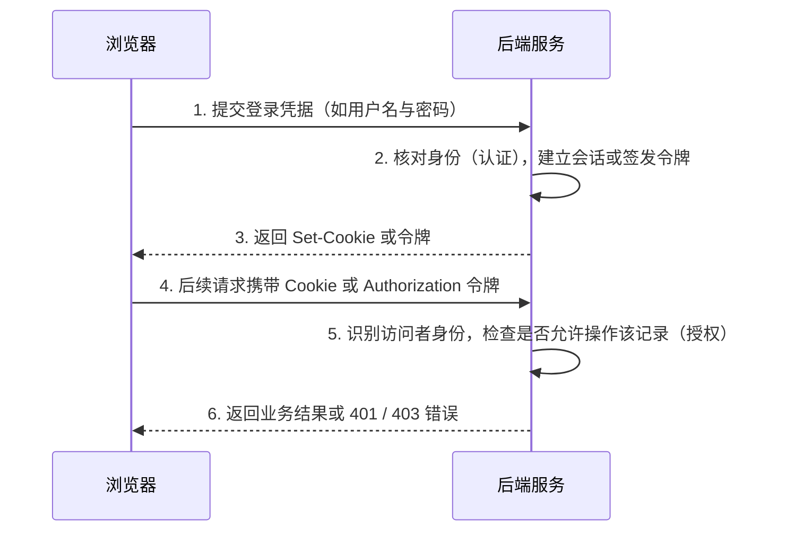

# 登录、状态与访问权限

你在网站登录一次，接下来打开多个页面通常不需要重复输入密码。网站需要某种办法，把后续请求与已经建立的身份或交互状态联系起来。

## 先分清认证与授权

**认证**帮助确认访问者是谁。**授权**判断这个身份能对哪些对象执行什么操作。

两个人都成功登录，不代表他们可以相互读取私有记录。服务器处理“读取编号为 17 的记录”时，还需要确认这条记录是否处于当前访问者的权限范围。仅知道编号，或者在前端显示了某个按钮，都不是完整的权限依据。

这两项工作相关，但不能合并成一句“已经登录，所以可以操作”。

## Cookie、会话与令牌怎样配合

Cookie 是浏览器按照相应规则保存并随请求携带数据的一种机制。会话描述跨请求延续的交互状态。令牌或会话标识，则可以作为识别这段状态或表达某种凭据的信息。

它们不是三种互相排斥的方案。一个网站可以把会话标识放进 Cookie，浏览器之后发送请求时携带它，服务器再据此查找会话。



另一类常见设计使用带签名的结构化令牌，例如 **JWT（JSON Web Token）**。使用 JWT 时有三个常被忽略的事实：① JWT 的载荷（payload）通常只是经过 Base64URL 编码而非加密，**任何人拿到令牌都能解码看到里面的明文字段**，绝不能在里面存放密码或密钥；② 签名只保证内容未被篡改，服务端每次收到请求时必须真正验证签名和过期时间；③ 不查库的纯无状态 JWT 在过期前很难由服务端单方面立即吊销。相关概念的联系见 [OWASP 会话管理说明](https://cheatsheetseries.owasp.org/cheatsheets/Session_Management_Cheat_Sheet.html)。

## 浏览器怎样收到与发送 Cookie

下面只展示字段关系，其中的值是虚构示意：

```http
Set-Cookie: session=example-session-id; HttpOnly; Secure; SameSite=Lax
```

服务器可以通过响应中的相应字段设置 Cookie。浏览器在规则允许的后续请求中，可能携带：

```http
Cookie: session=example-session-id
```

`HttpOnly` 禁止页面里的 JavaScript 通过 `document.cookie` 读取该 Cookie（防止发生 XSS 时令牌被脚本直接偷走；这也是为什么把会话令牌直接存在浏览器 `localStorage` 里一旦遇到 XSS 就会暴露）；`Secure` 要求仅通过 HTTPS 加密连接发送；`SameSite` 控制跨站请求时是否自动携带 Cookie，用于防范**跨站请求伪造（CSRF）**。这些属性各自处理一部分风险，都不能代替后端的授权检查。

此外，许多应用会提供“使用 Google / GitHub 账号登录”（通常基于 **OAuth 2.0 / OpenID Connect** 协议）。由于登录、密码散列（如 `Argon2id`、`bcrypt`）和会话管理细节极易出错，实际项目中应优先采用成熟的认证服务或框架内置模块，而不建议让 AI 从零手写整套密码与令牌逻辑。

Cookie 除了登录，还可以承担其他用途。因此，在浏览器中看见 Cookie，并不自动说明当前已经登录。

## 密码与会话凭据为什么要区别处理

密码通常用于建立身份，而后续访问可以使用会话凭据，从而不必每次都重新提交密码。服务端保存密码时，应采用适合密码的成熟处理机制，而不是把原始密码当成普通明文记录保存。

常见做法是使用专门的密码散列机制：结合随机盐等信息，把密码处理成供后续验证的结果。盐用于使相同密码也能得到不同的存储结果，不要求像密码一样保密；验证时通过相应算法比较，不需要把已存结果“解密回密码”。这与可逆加密不同，也不能用一次普通的快速哈希随意替代。具体方案应采用成熟库并遵循其当前配置建议，相关原理可参阅 [OWASP 密码存储说明](https://cheatsheetseries.owasp.org/cheatsheets/Password_Storage_Cheat_Sheet.html)。

会话凭据本身也需要被妥善管理，因为获得有效凭据的一方可能在一定范围内代表相应身份。退出登录、过期和撤销因此都是身份系统的一部分，而不只是把页面上的用户名隐藏起来。

## 前端能帮助用户，服务端承担最终判断

页面可以隐藏无权执行的按钮，减少用户困惑；但服务端仍要在实际请求到达时检查权限。浏览器中的代码和输入不能作为唯一可信来源。

同样，HTTPS 帮助保护通信，并不保证账号之间的对象访问规则正确。身份、传输、浏览器行为和业务授权各自处理一部分问题，理解这些职责，就能避免把“能登录”“有小锁”和“权限没有漏洞”当成同一句话。

> [!TIP]
> **实战提示**：登录解决的是“你是谁（认证）”，权限解决的是“你能不能改这条记录（授权）”；**不要让 AI 从零手写密码加密和会话系统**，优先使用框架内置或成熟的认证模块。

<!-- navigation -->

---

[上一篇：索引与事务](21-indexes-transactions.md) · [完整目录](../../README.md) · [按问题查阅](../questions.md) · [下一篇：把一次操作串起来](23-web-journey.md)
