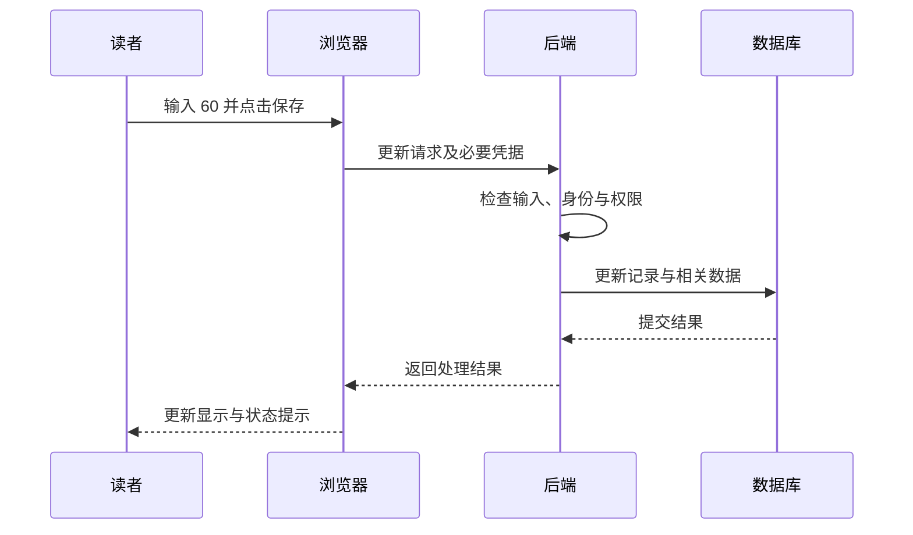

# 把一次操作串起来

现在用一个具体场景连接前面的知识：在在线读书记录中，把一本书的已读页数从 48 改成 60，然后点击保存。本篇只是解释一次交互，不要求读者制作这个应用。

## 操作开始前，页面已经经历了什么

浏览器需要取得页面及相关资源，并按应用的组织方式获得书目数据。有的内容由服务器直接生成，有的通过后续请求取得。浏览器把结构、样式和状态组织成用户看到的界面。

页面中的输入框此时可能显示 `48`。这个值是浏览器当前知道的状态，不会自动与数据库中的值时刻保持完全相同。其他设备上的修改、缓存或暂时的通信故障，都可能让双方观察到的状态有所差异。

## 从输入到请求

你输入 `60` 后，页面先获得一份新的输入值。它可能进行简单检查，例如判断是否能解释为允许的页数。随后，点击事件触发相应处理代码，组织更新请求。

在本教程的虚构接口中，这次请求可以使用 `PATCH /api/books/1`，内容包含 `read_pages` 为 60。浏览器根据应用和身份机制的安排携带必要凭据，再通过相应连接发送请求。

## 从请求到持久保存

服务器识别请求路径，解析输入，确定访问者，并检查其是否有权修改这条记录。然后验证业务条件，例如目标书目是否存在、总页数是否已知、60 是否处于允许范围。

规则满足后，后端向数据库提出更新。若同时维护阅读日志，可以按设计在同一事务中组织相关数据库修改。数据库提交成功后，服务器组织响应，说明接受了什么结果。

图画的是一次顺利完成的过程。具体应用可能增加队列、缓存等环节，但这些环节也需要放进明确的数据和状态流动中理解。

## “界面已经变了”能说明多少

有的界面先显示修改结果，再等待后端确认，这常被称为乐观更新。它能让操作显得及时，但失败时需要说明或恢复相应状态。另一些界面等到确认成功后才更新显示。

这两种方式都是设计选择。只凭数字从 48 变成 60，无法判断数据库是否已经提交。需要看更新发生在何时，以及失败处理怎样设计。

同样，“刷新以后仍然显示 60”是更进一步的观察，但还要知道刷新后读到的数据来自哪里。浏览器存储、缓存和远端数据库承担不同角色。

## 失败可能停在哪一段

| 观察到的情况 | 可以先辨认的环节 |
| --- | --- |
| 点击后没有相关请求 | 页面事件、输入检查或脚本执行 |
| 无法建立连接 | 地址、端口、网络或服务运行状态 |
| 返回请求或权限错误 | 输入约定、身份状态和对象授权 |
| 服务端报告处理失败 | 业务逻辑、数据库或其依赖 |
| 服务器已处理，页面却提示超时 | 响应传输与客户端等待过程 |

这些是定位入口，不是仅凭现象就能确定的结论。更可靠的判断需要把请求、响应、日志和实际数据对应起来。

## 重试为什么也需要规则

服务器可能已经保存，只是客户端没有收到成功响应。此时再次请求，如果业务是“把当前页数设为 60”，与“额外增加一条阅读记录”，重复产生的影响就可能不同。

系统可以通过明确的操作语义、请求标识、去重机制或版本条件处理相应情况。重试并不天然错误，但它需要与业务规则配合，而不能把所有失败都理解成“什么也没发生”。

到这里，界面、程序、网络、身份、数据库和状态提示已经连成一条可以追踪的过程。以后看到 AI 声称“修好了保存功能”，就可以理解它的改动落在哪个环节，以及什么观察能够支持这个结论。

<!-- navigation -->

---

[上一篇：登录、状态与访问权限](22-identity.md) · [完整目录](../../README.md) · [按问题查阅](../questions.md) · [下一篇：从需求到软件设计](24-requirements-design.md)
