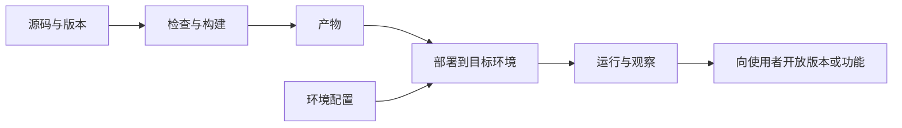

# 构建、发布与运行环境

开发者电脑里的源码，怎样变成别人能够使用的软件？这段过程可能包含转换文件、准备环境、启动服务和开放功能等多个动作。把它们分开，有助于理解“本地正常，线上却不一样”。

## 构建产生需要交付的内容

构建可以包括编译、打包、合并资源、生成文件或检查依赖等步骤，具体取决于项目。构建产物是这些步骤产生的内容，例如可执行文件、浏览器需要加载的静态资源或某种软件包。

有些小程序可以直接交给现成运行时执行，没有复杂的构建阶段。这不代表它完全没有运行条件，而是需要完成的转换与准备较少，或由运行环境承担。

改动源码后，如果使用者仍在运行旧产物，就不会自动得到新行为。“文件已经保存”与“当前运行的内容已经更新”仍然是两件事。

## 部署与开放功能

本教程把部署理解为把相应产物和配置安排进目标运行环境，把发布理解为让目标使用者获得某个版本或功能。不同平台的命名会有差异，但区分这些动作很有帮助。

代码可以先部署，再通过功能开关决定是否对用户开放。也可以由一条自动流程连续完成构建、部署和发布。它们连在一起，不意味着概念完全相同。[GitLab 的部署与发布介绍](https://docs.gitlab.com/user/get_started/get_started_deploy_release/)提供了相关流程示例。

## 开发环境与生产环境

开发环境便于修改、观察和定位问题，生产环境承担实际使用。两者可能在数据、权限、网络、依赖版本和配置上有所区别。

配置不应全部写死在代码里，例如不同环境连接的数据库地址。与此同时，**必须分清“服务端环境变量”与“前端公开环境变量”**：在 Vite、Next.js、Create React App 等常见前端工具中，凡是以 `VITE_`、`NEXT_PUBLIC_`、`REACT_APP_` 开头的变量，在执行构建打包时都会被**原样写进发给浏览器的 JavaScript 文件里**，任何访问者按 `F12` 都能直接看到。因此，不能仅因配置名字看起来像环境变量，就把它当成只有服务器知道的秘密。

真正的私有凭据（如大模型 API Key、数据库管理密码、支付密钥）只能保存在服务端环境：本地开发放在已加入 `.gitignore` 的 `.env` 里，线上部署则填在托管平台后台的 Environment Variables / Secrets 设置中，并为付费 API 设置用量上限（spend limit）告警。更一般地说，需要先知道代码和配置最后在哪里运行、谁能够取得它们，才能理解公开与私有的边界。

## 容器和托管服务解决哪部分工作

**容器**（如 Docker，通过打包好的镜像将应用及其系统依赖隔离运行）等技术帮助组织应用所需的内容与运行边界，使交付方式更明确。托管平台（如 Vercel、Render、Cloudflare Pages、云服务器等）则可能替开发者管理启动、网络或其他基础设施工作。需要注意，许多无服务器（Serverless）或容器托管平台的文件系统是**临时或只读**的——如果把数据直接写进容器本地的普通文件或本地 SQLite 文件，每次重新部署或实例重启后数据都会清空，线上持久化必须连接独立的数据库或对象存储服务。

这些能力不会消除业务代码本身的问题，也不意味着运行环境可以完全忽略。依赖、配置、资源限制和数据保存仍然会影响结果，只是其中一部分管理工作由其他组件承担。

## 持续集成把重复步骤连接起来

**持续集成（CI，Continuous Integration）**通常在代码提交或发起合并请求时（例如通过 GitHub Actions 的 `.github/workflows/*.yml`），自动在干净环境中运行约定的测试与构建，帮助尽早发现问题；**持续交付 / 部署（CD）**则可进一步把通过检查的产物自动部署上线。

流水线显示成功，只说明它配置的步骤成功。若没有包含数据库迁移检查、某项测试或环境验证，绿色状态就不能自动代表这些未执行的工作也已完成。

## 更新与恢复需要考虑数据

回到旧代码版本，不一定能让数据也回到旧结构。若新版本已经改变表结构或写入了新的数据形式，恢复时需要考虑兼容关系。

因此，发布是一个包含代码、配置、数据和使用状态的过程。遇到线上问题，可以沿这些组成部分比较环境，而不必一开始就把它归结为某个框架“在服务器上不稳定”。

> [!TIP]
> **实战提示**：检查环境变量命名：**凡是以 `VITE_`、`NEXT_PUBLIC_`、`REACT_APP_` 开头的变量都会被打包进浏览器公开代码**，私有 API Key 只能放在后端环境变量中。

<!-- navigation -->

---

[上一篇：测试在检查什么](29-testing.md) · [完整目录](../../README.md) · [按问题查阅](../questions.md) · [下一篇：维护、可靠性与基本安全](31-maintenance.md)
