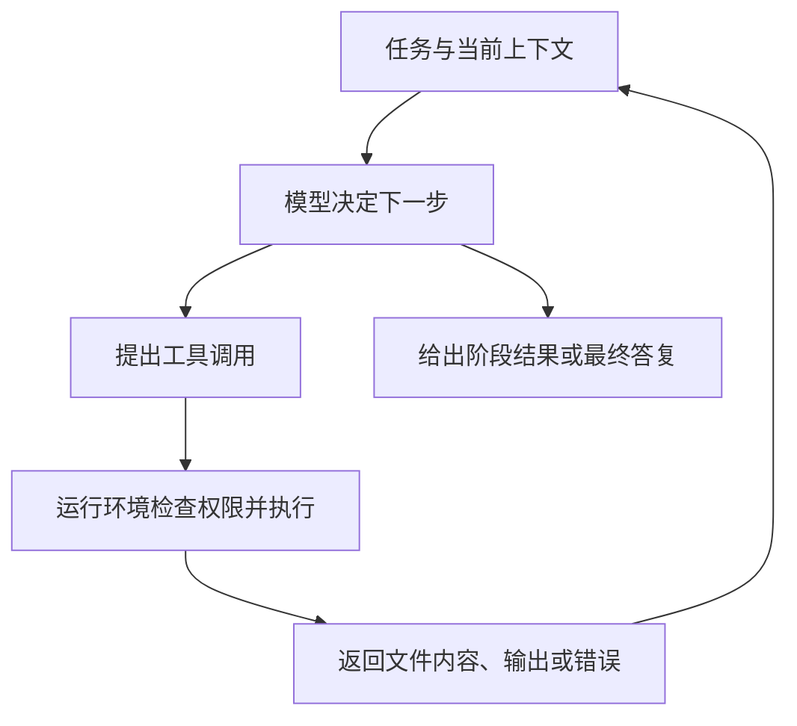

# 模型、上下文与开发工具

同样一句“修复保存失败的问题”，放进不同的 AI 产品，可能得到一段建议，也可能看到文件被修改、命令被执行。理解这种差异，需要把模型、产品、工具和运行环境分开。

## 模型是其中一个组件

这里讨论的语言模型，能够根据提供的信息生成文字、代码或结构化输出。模型经过训练形成处理这些信息的能力（注意模型训练有**知识截止时间**，对训练之后发布的框架新版本或新 API，若不提供文档上下文，模型很容易沿用过时的写法）；使用时，我们把任务及相关内容交给它取得一次输出，这个运行模型的过程通常称为**推理（inference）**——注意它与部分产品宣传中代表“先输出多步思考过程”的“推理模型（reasoning model）”不是同一个词。

围绕模型的产品还要负责许多事情：组织对话、收集项目内容、展示修改、连接工具、保存记录，以及决定哪些操作允许执行。因此，模型名称相同，也不意味着两个产品能访问相同文件、拥有相同工具或提供相同体验。

模型输出了一段命令，与这段命令已经执行，是两个不同状态。只有运行环境实际调用相应工具，命令才会影响文件或进程。

## 上下文是这一次能够参考的信息

**上下文**包括本次处理所提供的指令、对话、代码片段、文件内容、工具结果等。一个文件在你的电脑里，不等于模型已经读过；一个项目已经打开，也不保证全部文件都被交给模型。

产品可能主动选取相关内容，也可能让助手先搜索文件、再读取需要的部分。结果是否完整，取决于实际提供了什么，以及模型怎样使用它。解释项目时，如果没有读过对应文件，就不应把猜测当成已确认事实。

文本通常会被切分成 **token**，可以粗略理解为模型处理的文本片段。一个 token 不固定等于一个汉字、一个英文单词或一个字节；切分方式取决于所用的**分词器（tokenizer）**。产品介绍中的“上下文窗口”，描述的是一次处理可容纳信息（通常同时计入输入与输出 token）的容量边界，token 数量也会直接影响响应速度与调用费用。

容量大不等于其中每条信息都会被准确使用。彼此矛盾的要求、过期的日志和大量无关内容，仍可能妨碍理解。清楚标明哪些是当前状态、哪些是历史记录，有助于减少这种混淆。[关于上下文组织与有限容量的工程说明](https://www.anthropic.com/engineering/effective-context-engineering-for-ai-agents)

## 工具让模型有机会接触实际环境

一种常见的工具调用过程如下：

例如，助手先读取保存按钮的处理函数，再查看后端路由，然后运行一个能复现问题的检查。每次工具返回的结果，都可以成为下一步判断的依据。工具返回“找不到文件”，也应当影响后续计划。

人们常用 **agent（智能体）**描述能够在多步过程中选择并使用工具、根据反馈继续行动的系统。不同产品对这个词的范围不完全一致；这里关心的是“模型—工具—反馈”的运行机制，而不是某个标签是否听起来更强。[Anthropic 对工具循环与 agent 的说明](https://www.anthropic.com/engineering/building-effective-agents)

## 记忆需要保存，也需要被重新使用

对话记录、项目说明和长期偏好，可以保存在模型外部的存储中。产品若在后续处理时加载相关内容，它们才有机会影响这一次回答。这与模型训练时形成的参数不同。

因此，“已经写进文件”和“每次都会读到”之间还隔着检索与加载机制。聊天变长时，有的产品还会压缩历史或选取相关片段，早先的细节可能在这个过程中丢失。具体行为要以产品说明和可观察结果为准。

对于项目，更稳定的做法是在项目根目录下维护一份**项目规则与说明文件**——例如当前许多 AI 编程工具共同支持的 `AGENTS.md`（或特定工具使用的 `CLAUDE.md`、`GEMINI.md`、`.cursorrules`、`.github/copilot-instructions.md`）。在这份简短文件里写明：**项目的目录职责、启动与测试命令、代码约定，以及明确的禁止事项**（例如“安装新依赖前先询问”“不要修改数据库迁移历史”“不要读取或输出 `.env`”）。这样每次开启新会话时，工具都能自动把这些关键约束加载进上下文，而不必靠长对话反刍。[关于上下文组织与有限容量的工程说明](https://www.anthropic.com/engineering/effective-context-engineering-for-ai-agents)

## 权限来自运行环境

工具能读哪些目录，能否联网，能否修改数据库，通常由产品、操作系统、账号及其授权机制共同限制（包括通过 **MCP，Model Context Protocol** 等协议接入的外部工具，同样属于需要审查的信任边界）。提示词中的“请小心”有助于表达意图，但它本身不会建立文件系统隔离或数据库权限。因此，使用能够执行命令的智能体时，建议开启**执行命令前需人工确认**的审批模式，对删除文件（`rm -rf` / `Remove-Item -Recurse`）、强制覆盖 Git 历史（`git reset --hard` / `git push --force`）、修改生产数据库等高危操作始终保持人工把关。

如果一个助手无法访问浏览器，它就不能仅凭推测声称自己检查过页面；如果没有执行测试，也不能把建议运行的命令当成测试通过的证据。判断“它做了什么”，需要查看实际动作与结果。

理解这几层之后，许多看似神秘的现象就有了具体解释：助手不知道某个文件，可能是没有读取；记不住约束，可能涉及保存与加载；没有真正修复问题，可能是只生成了建议，也可能是执行后缺少有效验证。定位差异，才能决定应补充什么信息或调整什么环境。

> [!TIP]
> **实战提示**：在你的项目根目录建一个简短的 **`AGENTS.md`（或 `CLAUDE.md`）**，写清目录职责、启动/测试命令和禁止事项；当对话太长 AI 开始忘事时，带着总结开启一个新会话。

<!-- navigation -->

---

[上一篇：AI 编程与 Vibe Coding](32-ai-coding.md) · [完整目录](../../README.md) · [按问题查阅](../questions.md) · [下一篇：与 AI 讨论需求和修改](34-ai-collaboration.md)
